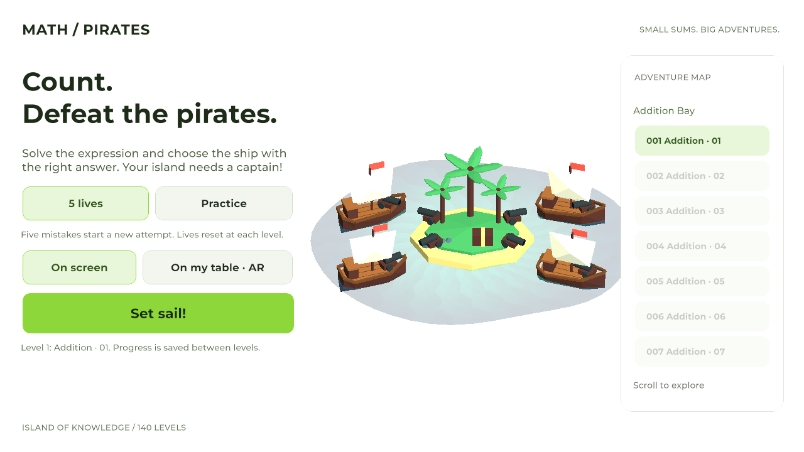
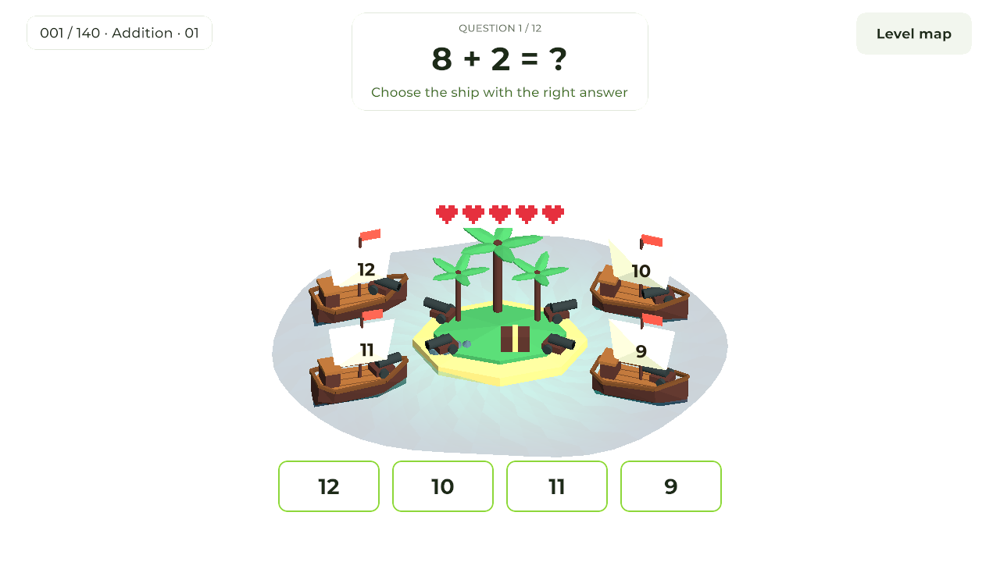

# MathPiratesAR

A math adventure about defending an island from pirates. Solve the expression and tap the ship carrying the correct answer. Play on screen or place the island on a real table with your Android camera.

## Features

- **140 levels across seven sections**, with 20 levels in each: addition, subtraction, both combined, multiplication, three operations combined, exact division, and all four operations combined.
- **1,680 original problems** with four unique answer choices, non-negative answers and division without remainders. Mixed sections combine operations within each expression.
- **Two game modes:** five lives per level or unlimited practice with correct and incorrect answer counters.
- **Progressive unlocks**, replay from the level map and saved progress between levels for each game mode.
- **Surface-based AR:** place and reposition the island on a table or floor, with an on-screen mode available without ARCore or camera permission.
- **Tap a ship or its sail number** to answer in AR. On-screen mode also provides large answer buttons.
- **Cannon battles:** four island cannons fire at the selected ship on correct answers; a wrong answer makes that ship fire back. Cannonballs, recoil, impacts and sinking animations are created for this project.
- **Original low-poly ships and island**, readable numbers on sails and gentle ship movement.
- **Transparent, animated polygonal water** with waves calculated on the GPU.
- **Light landscape interface** with solid colors, green accents, Montserrat typography and display cutout support.
- **English and Russian localization**, selected from the system language with English as the fallback.

## Screenshots

  

  

